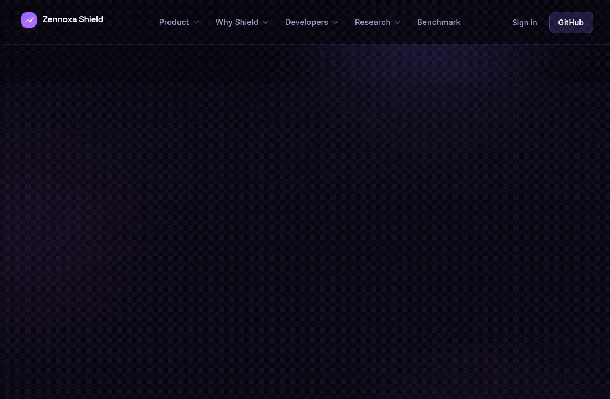
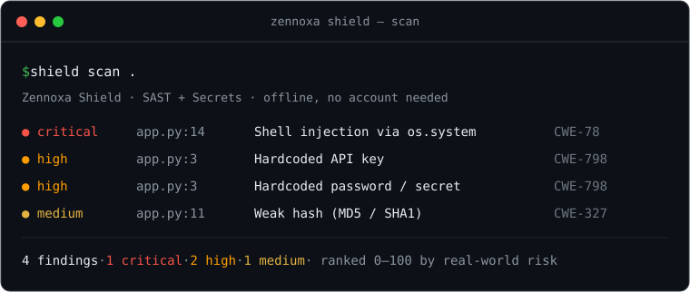
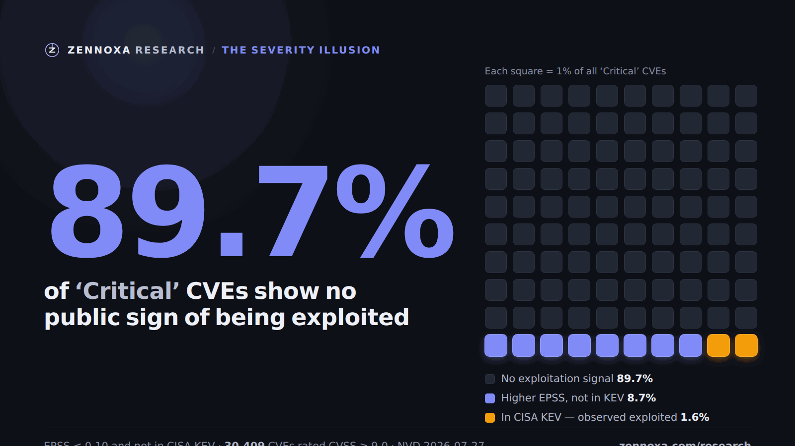

<div align="center">

# Zennoxa Shield

**Find, prioritize & fix code security risks — one scan, every layer.**

[Website](https://zennoxa.com) · [Report an issue](https://github.com/Zennoxa/shield/issues)

[](https://github.com/Zennoxa/shield/releases/latest)
[](./LICENSE)


[](./bench/owasp/benchmark.json)

</div>

<p align="center">
  
</p>

<p align="center"><em>Shield's <b>Priority Engine</b> re-orders findings by real-world exploitability — the reachable, exploitable bug rises to the top.<br><sub>Hosted dashboard shown. The <code>shield</code> CLI prints an offline priority for every finding that has a CVSS value, in text, JSON and SARIF: CVSS and reachability, plus EPSS and CISA KEV for dependency CVEs when you pass <code>--deps</code>.</sub></em></p>

<p align="center">
  
</p>


---

**Zennoxa Shield is a static security scanner for source code, secrets, dependency manifests, Dockerfiles and infrastructure-as-code.** In one command it runs static analysis (SAST), secret scanning, dependency / software-composition analysis (SCA), container and infrastructure-as-code (IaC) checks over your codebase — then ranks every finding by real-world exploitability, so you fix what actually matters instead of a wall of "critical" alerts.

The `shield` CLI is a free binary released under the MIT license (its source is not public and is not in this repository). It runs offline from the command line, and outputs **SARIF** for GitHub code scanning and CI security gates across **25 programming languages**. What sets Shield apart from most scanners is its **Priority Engine**: instead of sorting by raw severity, it blends CVSS, EPSS, CISA KEV and code reachability into one **0–100 score**, so the genuinely exploitable findings rise to the top. Offline, the CLI scores with CVSS and reachability only (so at most 45 of 100) and adds EPSS and KEV for dependency CVEs when you pass `--deps`; the hosted dashboard keeps those two signals fresh for every finding that has a CVE.

> **This repository** hosts the Shield CLI releases, documentation and the community issue tracker. The scanning engine is compiled into the CLI binary and runs on your machine; its source is not public. The dashboard at **[zennoxa.com](https://zennoxa.com)** is a separate proprietary service that stores and re-ranks the findings you choose to submit — free during beta.

## Latest research

**The Severity Illusion — 9 in 10 "Critical" CVEs show no sign of being exploited.**
We joined three public datasets (NVD CVSS · FIRST EPSS · CISA KEV) across all
30,409 CVSS-9.0+ CVEs: **89.7%** sit below an EPSS exploitation probability of
0.10 *and* never appear in CISA's Known Exploited Vulnerabilities catalog — only
**1.6%** are in KEV. Every figure is reproducible from the three public snapshots.

→ **Read the study:** https://zennoxa.com/research/severity-illusion-critical-cves-2026

<p align="center">
  <a href="https://zennoxa.com/research/severity-illusion-critical-cves-2026">
    
  </a>
</p>

_This is exactly what Shield's Priority Engine solves: it blends CVSS, EPSS, KEV
and reachability into one 0–100 score so the ~10% that actually matter rise first._

## What it checks

| Layer | What Shield finds |
| --- | --- |
| **Code (SAST)** | Insecure patterns across **25 languages** (14 with comprehensive coverage, a small number of rules each for the other 11) — injection, XSS, weak crypto, unsafe deserialization, and more |
| **Secrets** | **26 credential patterns** — cloud keys, tokens, private keys, database URLs, provider API keys |
| **Dependencies (SCA)** | Known CVEs via **[OSV.dev](https://osv.dev)** + a **CycloneDX 1.4 SBOM** |
| **Containers** | Dockerfile and Kubernetes manifest misconfigurations; `shield image-scan` inspects a registry image's config and build history without pulling layers (`--os-cve` adds OS-package CVEs) |
| **Infrastructure-as-Code** | Terraform & Kubernetes misconfigurations |
| **License compliance** | Dependency license risks *(hosted)* |
| **Priority Engine** | A **0–100 priority score** — CVSS + EPSS + CISA KEV + code reachability ([what the CLI computes offline](#how-prioritization-works--the-priority-engine)) — so the noise sinks and the exploitable issues rise |

## Supported languages (SAST)

**14 with comprehensive coverage:** C · C++ · C# · Dart · Go · Java · JavaScript · Kotlin · PHP · Python · Ruby · Rust · Swift · TypeScript

**Plus lighter coverage for 11 more:** Scala · Solidity · PowerShell · Groovy · Lua · Perl · Objective-C · VB.NET · Shell · SQL · Vyper

— and **YAML · Terraform · Kubernetes · CloudFormation (basic) · Dockerfile · Helm** for config / IaC.

## Measured results

> Per-target notes for everything we tested (OWASP Benchmark, Juice Shop, WebGoat, DVNA, Kubernetes Goat, terragoat) are in [docs/EVIDENCE.md](docs/EVIDENCE.md).

_Measured by us with the released CLI at its default configuration. Results vary with version, configuration and codebase. Last re-scored on the v0.7.0 release binary on 2026-09-21._

### OWASP Benchmark v1.2 (third-party test suite)

The [OWASP Benchmark](https://owasp.org/www-project-benchmark/) is a public suite of **2,740 labelled Java test cases** (score = True Positive Rate − False Positive Rate, higher is better). Shield scores a **Benchmark Score of +0.582 at 92.5% precision** (recall 63.7%, false-positive rate 5.5%) — see [`bench/owasp/benchmark.json`](bench/owasp/benchmark.json) for the per-category breakdown. The benchmark is Java only; it says nothing about the other languages or the secret, dependency, container and IaC layers.

What you can and cannot check today: the suite and its expected-results file are public, and the scan is one command (`shield scan <BenchmarkJava>/src/main/java/org/owasp/benchmark/testcode --format json --output findings.json`). The script that maps Shield's findings to the suite's categories and computes the score is not in this repository yet, so until it is, treat the number as our measurement rather than something you can reproduce end to end.

### Dependency (SCA) scanning — a run you can repeat

```bash
git clone https://github.com/appsecco/dvna && cd dvna && git checkout 9ba473a
shield scan . --deps
```

With v0.7.0 on 2026-09-21 this reports 35 dependency findings for DVNA's 19 declared packages, for example CVE-2017-5941 (node-serialize 0.0.4) and CVE-2022-29078 (ejs 2.5.7), next to 10 code findings and 2 container findings. Advisory data comes from [OSV.dev](https://osv.dev), so the count grows as new advisories are published, and the priority of dependency findings moves with EPSS.

Shield runs SAST, Secrets, SCA, Container, and CI/CD checks in a single local scan (dependency lookups with `--deps` need the network), with findings ranked by severity, reachability and, for dependency CVEs, EPSS/KEV.

### A note on precision

Shield is **precision-first**: it is tuned to keep false positives low so that the findings you see are the ones worth acting on. As a trade-off, on some datasets its recall is not the highest — on OWASP v1.2, for example, Shield reaches 92.5% precision at roughly 64% recall. We think fewer, higher-confidence findings are the right default, and the CLI is free to run on your own code so you can judge the trade-off there.

---

_"OWASP" and "OWASP Benchmark" are trademarks of the OWASP Foundation, used here for identification only; this project is not affiliated with, endorsed by, or sponsored by the OWASP Foundation. The OWASP Benchmark test suite is used under its open-source license._

## Install the CLI

### macOS and Linux

```bash
curl -fsSL https://raw.githubusercontent.com/Zennoxa/shield/main/install.sh | sh
```

[`install.sh`](install.sh) downloads the release binary for your machine, checks it against the release's `SHA256SUMS` (it stops if the checksum is missing or wrong), installs it as `shield` and runs `shield version`. It installs to `/usr/local/bin` when that is writable or `sudo` can be used, otherwise to `~/.local/bin`, and tells you if that folder is not on your `PATH`. Pin a release with `SHIELD_VERSION=v0.7.0`, choose the folder with `SHIELD_INSTALL_DIR`.

### Windows (PowerShell)

```powershell
irm https://raw.githubusercontent.com/Zennoxa/shield/main/install.ps1 | iex
```

[`install.ps1`](install.ps1) does the same on Windows: it installs `shield.exe` under `%LOCALAPPDATA%\Programs\shield` and adds that folder to your user `PATH`. No administrator rights are needed. Open a new terminal afterwards, then run `shield version`.

### Homebrew (macOS / Linux)

```bash
brew install zennoxa/tap/shield
shield version
```

### Manual download

Every release on the **[Releases](https://github.com/Zennoxa/shield/releases/latest)** page carries one file per platform and a `SHA256SUMS` file.

| Platform | File |
|---|---|
| Linux x86-64 | `shield-linux-amd64` |
| Linux ARM64 | `shield-linux-arm64` |
| macOS Apple silicon | `shield-darwin-arm64` |
| macOS Intel | `shield-darwin-amd64` |
| Windows x86-64 | `shield-windows-amd64.exe` |

```bash
# Linux and macOS: replace the file name with the one for your platform
curl -fsSLO https://github.com/Zennoxa/shield/releases/latest/download/shield-linux-amd64
curl -fsSLO https://github.com/Zennoxa/shield/releases/latest/download/SHA256SUMS

# verify (prints "shield-linux-amd64: OK"); on macOS use: shasum -a 256 -c -
grep ' shield-linux-amd64$' SHA256SUMS | sha256sum -c -

chmod +x shield-linux-amd64 && sudo mv shield-linux-amd64 /usr/local/bin/shield
shield version
```

Three things that stop people after a manual download:

- **The file is not called `shield`.** Rename it (`shield`, or `shield.exe` on Windows) and put its folder on your `PATH`; otherwise the command in every example is not found. On Windows, double-clicking the file only flashes a console window: Shield is a command-line program, run it from PowerShell or Command Prompt.
- **macOS blocks a file downloaded with a browser** ("cannot be opened because the developer cannot be verified"). The release binaries are not notarized by Apple. A file fetched with `curl`, the install script or Homebrew is not affected. For a browser download, check the checksum, then clear the flag: `xattr -d com.apple.quarantine ./shield-darwin-arm64`.
- **Windows SmartScreen warns about a file downloaded with a browser** ("Windows protected your PC"). The release binaries are not code-signed. Check the checksum with `Get-FileHash .\shield-windows-amd64.exe -Algorithm SHA256` against `SHA256SUMS`, then choose "More info" and "Run anyway", or use the install script above, which is not affected.

### The script on zennoxa.com

`curl -sSL https://zennoxa.com/install | sh` is the same kind of installer served from the product site. It also downloads from this repository's releases.

## Quick start

```bash
# Scan a project locally — SAST + secrets, no account needed
shield scan .

# Add dependency (SCA) analysis
shield scan . --deps

# Scan a container image
shield image-scan myorg/myapp:1.4

# Log in and submit results to your dashboard
shield login
shield scan . --submit --project YOUR-PROJECT-ID --org YOUR-ORG-ID
```

Browse and triage findings at **[zennoxa.com](https://zennoxa.com)**.

## Use Shield from your AI coding agent (MCP)

Since v0.7.0 the same binary runs as a [Model Context Protocol](https://modelcontextprotocol.io) server over stdio, so an MCP client such as Claude Code or Cursor can scan a repository, page through findings by priority, read the flagged line with fix guidance, look up a rule, apply a gate and list SBOM components.

```bash
# Claude Code
claude mcp add shield -- shield mcp
# or confine scans to the project directory:
claude mcp add shield -- shield mcp --root .
```

```json
// Other MCP clients (mcp.json)
{ "mcpServers": { "shield": { "command": "shield", "args": ["mcp"] } } }
```

| Tool | What it does |
| --- | --- |
| `shield_scan` | Scan a directory; returns a scan id, severity counts and the top 25 findings by priority |
| `shield_findings` | Page and filter a scan's findings (severity, rule, file, minimum priority, reachable only) |
| `shield_finding` | One finding: file and line, flagged snippet, the recommendation where the engine has one (secret and Terraform findings carry only title and CWE), rule guidance for catalogued SAST rules |
| `shield_rule` | Look up a catalogued SAST rule by id |
| `shield_gate` | Pass/fail on a severity, grade or score threshold |
| `shield_sbom` | CycloneDX or SPDX components, paged |

What touches the network:

| Mode | Leaves the machine |
| --- | --- |
| `shield_scan` (default) and every other tool | Nothing |
| `shield_scan` with `deps=true` | Package names and versions to OSV.dev, CVE ids to FIRST EPSS, CISA KEV feed download. No source code |
| Tool results | Returned to your agent (finding metadata and the flagged line), which forwards them to its model provider like any tool output |

Things to know: the tools only read from disk. Secret values in secret findings are masked before they are returned (pattern-based, best effort). Shield does not edit code; the agent does. Each finding carries a `fingerprint`, a hash of the rule, file path and flagged line text: it survives line-number shifts and changes when the file is renamed or that line is edited, so a rescan shows what was fixed. One scan runs at a time, with `--scan-timeout` (default 10m); `shield mcp --root DIR` rejects scan paths outside DIR (a path check: symlinks inside DIR are still followed), and `/`, `/proc`, `/sys`, `/dev`, `/run` and `/boot` are refused as scan roots. We have run the scan and finding tools end to end with Claude Code 2.1 and with the official MCP Go SDK client; other stdio clients should work but are not tested by us yet. More detail: [zennoxa.com/mcp](https://zennoxa.com/mcp).

## Pre-commit hook

Run Shield before every commit with [pre-commit](https://pre-commit.com). Install the `shield` CLI first (Homebrew or a release binary above), then add to your project's `.pre-commit-config.yaml`:

```yaml
repos:
  - repo: https://github.com/Zennoxa/shield
    rev: v0.7.0
    hooks:
      - id: shield
```

```bash
pre-commit install
pre-commit run shield --all-files
```

The hook scans the whole repository and blocks the commit on any finding of any severity. If the scan itself cannot finish it also blocks, and says so instead of reporting findings. Findings you have suppressed (`.shieldignore`, inline `shield:ignore`) do not block. Bypass with `git commit --no-verify`.

## Use it in CI

Add the **Zennoxa Shield GitHub Action**: one step, nothing to install. It runs on Linux, macOS and Windows runners, x86-64 and ARM64.

```yaml
# .github/workflows/security.yml
name: Security
on: [push, pull_request]
permissions:
  contents: read
jobs:
  shield:
    runs-on: ubuntu-latest
    steps:
      - uses: actions/checkout@v7
      - uses: Zennoxa/shield@v0.7.0     # pin to a tag or commit SHA
        with:
          version: v0.7.0              # the scanner release to run (default: latest)
          args: --deps                 # also scan dependencies (SCA)
```

By default the step reports and passes. To block a pull request, choose one:

```yaml
        with:
          args: --deps --fail-on-severity high   # fail when a finding is high or critical
```

```yaml
        with:
          fail-on-findings: true                 # fail on any finding at all
```

To see the findings in the repository's **Security** tab, write SARIF and upload it (free for public repositories; private repositories need GitHub code scanning):

```yaml
permissions:
  contents: read
  security-events: write
jobs:
  shield:
    runs-on: ubuntu-latest
    steps:
      - uses: actions/checkout@v7
      - uses: Zennoxa/shield@v0.7.0
        with:
          version: v0.7.0
          format: sarif
          output: shield.sarif
      - uses: github/codeql-action/upload-sarif@v4
        if: always()
        with:
          sarif_file: shield.sarif
```

| Input | Default | Meaning |
|---|---|---|
| `path` | `.` | Folder to scan |
| `args` | | Extra flags for `shield scan`, for example `--deps --fail-on-severity high` |
| `format` | `json` | `json` or `sarif` |
| `output` | `shield-report.json` | Report file |
| `version` | `latest` | Scanner release, for example `v0.7.0` |
| `token` | | CLI token or API key for `--submit`; a `SHIELD_CLI_TOKEN` in the job environment also works |
| `fail-on-findings` | `false` | Fail the step on any finding |

Outputs: `report` (the report file), `findings` (how many), `exit-code` (of `shield scan`), `version` (the scanner release that ran). Ready-made workflows are in [`examples/`](examples/).

## How prioritization works — the Priority Engine

Most scanners drown you in findings. Shield's **Priority Engine** scores findings **0–100** from four signals, not just severity:

```
Priority = CVSS·0.30 + EPSS·0.30 + KEV·0.25 + reachability·0.15
```

- **CVSS** — the vulnerability's base severity.
- **EPSS** — FIRST.org's probability it will be exploited in the wild in the next 30 days (where a CVE is known).
- **CISA KEV** — whether it appears in the Known Exploited Vulnerabilities catalog (proven exploited in the real world).
- **Reachability** — true when Shield's taint pass traces untrusted input to the flagged sink within the same file. It is not call-graph analysis; cross-file flows are missed.

So the list sorts by what's genuinely exploitable — not just what's noisy. You fix the top and move on.

**What the CLI computes offline.** A signal that is not available contributes zero. A plain `shield scan .` has CVSS and reachability, so its scores top out at 45. With `--deps`, dependency CVEs also get EPSS and CISA KEV. Findings without a CVE (code, secrets, configuration) have no EPSS or KEV anywhere, so 45 is their ceiling on the dashboard too; the hosted dashboard keeps EPSS and CISA KEV fresh for findings that do have a CVE. Findings whose rule has no CVSS value (container-config and Terraform rules today) are not scored. The CLI prints which basis it used: `PriorityBasis` in JSON, `properties.priorityBasis` in SARIF, and a legend line in text output.

## FAQ

**What is Zennoxa Shield?** Zennoxa Shield is a security scanner that finds vulnerabilities across your code (SAST), dependencies (SCA), secrets, containers and infrastructure-as-code in a single scan, then ranks every finding **0–100** by real-world exploitability. The `shield` CLI in this repo is free and MIT-licensed; a hosted dashboard at [zennoxa.com](https://zennoxa.com) adds team and organization features.

**Is the `shield` CLI free? How is it licensed?** The `shield` binary and the documentation in this repository are released under the [MIT license](./LICENSE): free to use, run in CI and redistribute, no account. The engine source is not public. The hosted dashboard at zennoxa.com is a separate, proprietary service.

**Is it free?** The CLI is free with no time limit. The hosted dashboard is free during beta for up to 5 repositories, no credit card; pricing after the beta has not been set.

**Does my code leave my machine?** `shield scan .` runs locally and makes no network requests. With `--deps`, package names and versions are sent to OSV.dev, CVE ids to FIRST EPSS, and the CISA KEV feed is downloaded; source code is not sent. Nothing is uploaded unless you pass `--submit`. Then, per finding, the CLI sends the rule id, severity, file path, line number, the flagged source line, the recommendation and the CVE id, plus the git branch and commit. For secret findings the flagged line is the line that contains the secret, so review what you submit.

**Which languages are supported?** 25 for SAST — 14 with comprehensive coverage plus a small number of rules each for 11 more (see the list above). Secret and container scanning are language-agnostic; dependency scanning covers 10 ecosystems (npm, PyPI, Go, Maven, NuGet, Packagist, Pub, RubyGems, crates.io, Hex).

**Does Shield output SARIF / work with GitHub code scanning?** Yes. `shield scan . --format sarif` emits [SARIF](https://sarifweb.azurewebsites.net/) you can upload to GitHub code scanning or feed to any SARIF-aware CI or security gate. See the GitHub Action example above.

**How is Shield different from Snyk, Semgrep, SonarQube or Trivy?** Most scanners hand you a long list sorted by raw severity. Shield's **Priority Engine** ranks findings by *exploitability* — blending CVSS, EPSS, CISA KEV and code reachability — so you act on the ~10% that actually matter, and it covers multiple layers in one scan: SAST, secrets, container and IaC checks run offline, and SCA with `--deps` queries OSV.dev. Rather than take our word for it, run it next to any other tool at its defaults on your own code and compare.

**Can I run it in CI?** Yes — see the GitHub Actions example above. Any CI that can run a binary works.

## Contributors welcome

New here? We've labelled a handful of **[good first issues](https://github.com/Zennoxa/shield/labels/good%20first%20issue)** — CI examples (GitLab, Bitbucket, Jenkins), a SARIF → GitHub code-scanning guide, and an example `.shieldignore`. They're self-contained and need no engine internals. The engine source is closed, so bug and false-positive reports are the most useful contribution. Open a PR or say hi in an issue — see [CONTRIBUTING.md](./CONTRIBUTING.md).

## Community & support

- **Bugs / feature requests** → [open an issue](https://github.com/Zennoxa/shield/issues)
- **Found a security vulnerability?** → please report it privately via [GitHub Security Advisories](https://github.com/Zennoxa/shield/security/advisories/new). See [SECURITY.md](./SECURITY.md).
- **Contributing** → [CONTRIBUTING.md](./CONTRIBUTING.md)
- **Product & sign-up** → [zennoxa.com](https://zennoxa.com)

## License

The CLI binary and the documentation in this repository are released under the [MIT License](./LICENSE). The engine source is not public. The hosted dashboard is a separate, proprietary service.

---

<div align="center">© Zennoxa · <a href="https://zennoxa.com">zennoxa.com</a></div>
